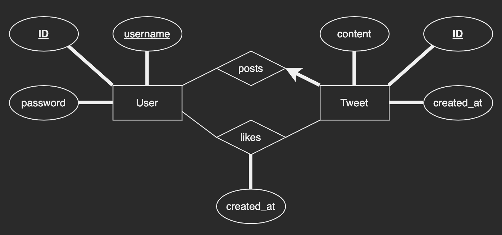

# Job Application Tracker

## Project Description

Job Application Tracker is a backend application built with Python, Flask, SQLAlchemy, and PostgreSQL.

The project is designed to manage job applications and track their statuses. It uses a relational database to organize information about users, profiles, companies, jobs, applications, and skills.

The application provides a REST API for creating, viewing, updating, deleting, and filtering job applications.

This project was originally developed during the SQL with Python course and has been extended as part of the Modern Software Engineering with DevOps course at Nucamp.

## Technologies Used

- Python
- Flask
- Flask-SQLAlchemy
- PostgreSQL
- SQLite (for automated tests)
- Docker
- REST API
- SQL
- pytest
- GitHub Actions
- Git and GitHub

## Database Design

The database contains seven tables:

- **users** — stores user information.
- **profiles** — stores additional user profile information.
- **companies** — stores company information.
- **jobs** — stores job postings and their associated companies.
- **applications** — connects users to jobs and tracks application statuses.
- **skills** — stores skill names.
- **job_skills** — connects jobs and skills through a many-to-many relationship.

The database uses primary keys and foreign keys to maintain relationships between tables.

### Database Schema



## API Reference

### Existing Endpoints

| Method | Endpoint | Description | Parameters |
|---|---|---|---|
| GET | `/applications` | Retrieve all applications | None |
| GET | `/applications?status=Applied` | Filter applications by status | Optional `status` query parameter |
| POST | `/applications` | Create a new application | JSON: `user_id`, `job_id`, `status` |
| PUT | `/applications/{application_id}` | Update an application's status | URL: `application_id`; JSON: `status` |
| DELETE | `/applications/{application_id}` | Delete an application | URL: `application_id` |

### Planned Endpoints

| Method | Endpoint | Description |
|---|---|---|
| GET | `/applications/{application_id}` | Retrieve a single application |
| GET | `/companies` | Retrieve companies |
| GET | `/jobs` | Retrieve job postings |

### Example POST Request

```json
{
  "user_id": 1,
  "job_id": 1,
  "status": "Applied"
}
```

## New Feature: Application Status Filtering

During Project Week, I implemented a new feature that allows users to filter job applications by status.

The API accepts an optional `status` query parameter.

Examples:

**Retrieve all applications:**

```http
GET /applications
```

**Retrieve applications with the status Applied:**

```http
GET /applications?status=Applied
```

**Retrieve applications with the status Interview:**

```http
GET /applications?status=Interview
```

The filtering functionality is implemented using SQLAlchemy queries in `routes.py`.

If no status is provided, the API returns all applications.

This feature helps users organize job applications and monitor their progress through different stages of the application process.

## Database Performance Optimization

A B-tree index was created on the `status` column of the `applications` table.

```sql
CREATE INDEX IF NOT EXISTS ix_applications_status
ON applications (status);
```

The index was verified in PostgreSQL using the `pg_indexes` system view.

This index can improve the performance of queries that filter applications by status, particularly as the table grows.

## Automated Testing with pytest

Automated API tests were implemented using pytest.

The tests are located in:

`tests/test_applications.py`

The project currently includes four automated tests:

1. Retrieve job applications successfully.
2. Return HTTP 404 when updating a nonexistent application.
3. Return HTTP 404 when deleting a nonexistent application.
4. Filter job applications by status.

The tests use Flask's test client and mock database operations to avoid modifying production data.

### Run Tests Locally

Install dependencies:

```bash
pip install -r requirements.txt
```

Run the tests:

```bash
python -m pytest -v
```

### Test Results

All four automated tests passed successfully.

```text
tests/test_applications.py::test_get_applications PASSED
tests/test_applications.py::test_update_nonexistent_application PASSED
tests/test_applications.py::test_delete_nonexistent_application PASSED
tests/test_applications.py::test_get_applications_filter_by_status PASSED

4 passed in 0.82s
```

## Continuous Integration with GitHub Actions

GitHub Actions was configured to automatically run the project's tests whenever code is pushed to the `master` branch or a pull request targets that branch.

The workflow configuration is located at:

`.github/workflows/main.yml`

### CI Workflow

The automated workflow performs the following steps:

1. Checks out the GitHub repository.
2. Sets up Python 3.12.
3. Installs the required Python dependencies.
4. Runs the pytest test suite.
5. Reports whether the tests passed or failed.

The workflow runs on a GitHub-hosted Ubuntu runner.

### GitHub Actions Results

The workflow completed successfully, including the new application status filtering test.

View the automated test results:

https://github.com/Olginsb/job-application-tracker/actions

This demonstrates Continuous Integration (CI) by automatically validating code changes.

## DevOps Progress

### Week 2: Docker and Containerization

During Week 2, I prepared the Flask application for containerization.

Work completed:

- Reused the existing Flask REST API project.
- Created a `requirements.txt` file.
- Created a Dockerfile.
- Updated database configuration to use environment variables.
- Added a `.gitignore` file.
- Updated project documentation.
- Prepared the application for containerized deployment.

### Week 4: GitHub Actions

During Week 4, I completed the alternative GitHub Actions CI challenge.

Work completed:

- Created a GitHub Actions workflow.
- Configured automated dependency installation.
- Configured Python 3.12 for CI.
- Added automated API testing using pytest.
- Verified successful workflow execution on GitHub.

This CI workflow does not require paid cloud infrastructure.

### Project Week: New Feature

During Project Week, I extended the original application by implementing application status filtering.

Work completed:

- Added an optional status filter to the GET `/applications` endpoint.
- Used SQLAlchemy to filter records by status.
- Preserved the existing behavior when no filter is provided.
- Added a new automated test for filtering.
- Verified that all four tests pass in GitHub Actions.
- Updated project documentation.

## Project Retrospective

### How did the project design evolve?

The project started with a relational database design for managing job applications.

The application was then connected to Flask using SQLAlchemy, and REST API endpoints were implemented to support basic CRUD operations.

A B-tree index was added to the application status column to support efficient filtering.

Later, the project was extended with Docker configuration, automated testing, GitHub Actions, and application status filtering.

### Did you use an ORM or raw SQL? Why?

I used SQLAlchemy as an Object-Relational Mapper (ORM) to define database models and perform CRUD operations.

SQLAlchemy made it easier to work with database records using Python objects and helped keep the application code organized.

I also used SQL directly to create and verify the database index.

### What would you improve in the future?

Future improvements could include:

- User authentication and authorization.
- Search and sorting functionality.
- Better input validation and error handling.
- Additional API endpoints for companies, jobs, and skills.
- A frontend dashboard to visualize application progress.
- Additional automated test coverage.
- Docker Compose configuration for Flask and PostgreSQL.
- Cloud deployment and automated delivery (CD).

## Future Development Roadmap

### Short-Term Goals

- Expand API test coverage.
- Improve input validation.
- Add more filtering and sorting options.

### Long-Term Goals

- Implement authentication and authorization.
- Develop a frontend dashboard.
- Add application statistics and reporting.
- Deploy the project to a cloud platform.
- Extend the CI workflow with deployment automation.

## Conclusion

Job Application Tracker demonstrates practical skills in:

- Python backend development.
- Flask REST API design.
- Relational database design.
- PostgreSQL and SQLAlchemy.
- CRUD operations and database indexing.
- Docker containerization preparation.
- Automated testing with pytest.
- Continuous Integration with GitHub Actions.
- API feature development and maintenance.

The project now includes application status filtering and an automated CI workflow with four successfully passing tests.

The goal is to continue developing this application into a complete job application management system.
